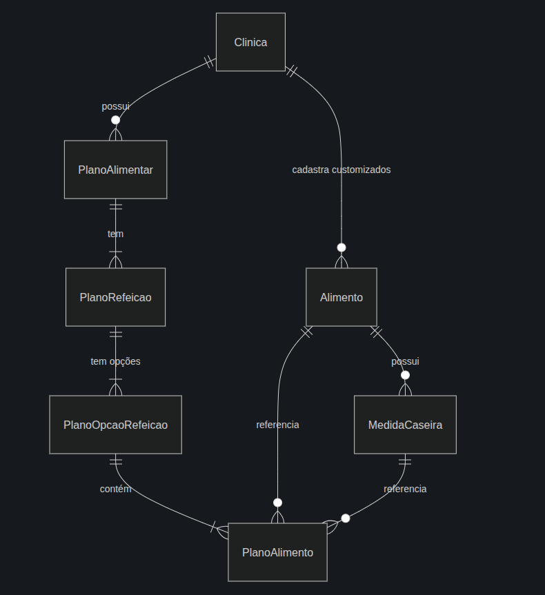

# Módulo de Prescrição Nutricional (Backend)

Este documento detalha a arquitetura, os fluxos de dados e as decisões de design do módulo de **Planos Alimentares e Alimentos**, focado nas necessidades de um sistema SaaS para gestão de clínicas de nutrição.

---

## 1. Visão Geral da Arquitetura

O sistema foi modelado para suportar **flexibilidade prescritiva** (permitindo substituições de alimentos) e **isolamento multi-tenant** (garantindo que cada clínica tenha seus próprios dados, além de acessar um banco global de alimentos).

### Diagrama Entidade-Relacionamento (Core)

---

## 2. Decisões de Design Críticas

### 2.1. O Padrão "Snapshot" (Imutabilidade Clínica)
A entidade `PlanoAlimento` possui relações diretas com o banco global via `alimentoId` e `medidaCaseiraId`. No entanto, ela **também salva os dados nutricionais diretamente na sua própria tabela** (`calorias`, `proteinas`, etc.).

**Por que isso foi feito?**
Em um software de saúde, o histórico médico é sagrado. Se o IBGE atualizar as macros de um alimento na Tabela TACO no ano que vem, ou se um nutricionista alterar os valores de um whey protein customizado, **os planos alimentares passados não podem ser alterados retrospectivamente**. 
A prescrição atua como uma "foto" tirada no dia da consulta. A referência por `ID` serve apenas para o frontend saber de onde aquele alimento veio, mas os cálculos do plano confiam sempre no *snapshot*.

### 2.2. Isolamento Multi-tenant (Banco TACO vs Customizado)
A tabela `Alimento` atende a dois propósitos através da coluna `clinicaId`:
- **Alimentos Globais (TACO):** Quando `clinicaId` é `null`. Ficam visíveis para todas as clínicas cadastradas no sistema.
- **Alimentos Customizados:** Quando `clinicaId` possui um ID. Um nutricionista pode criar um "Suplemento X" que será visível apenas na sua própria clínica.

> [!TIP]
> A busca na API (`GET /alimentos`) funde automaticamente essas duas origens e ordena priorizando os alimentos da própria clínica, facilitando a vida do nutricionista.

### 2.3. Flexibilidade: Opções de Refeição
Diferente de sistemas amadores que criam apenas uma lista de alimentos por refeição, incluímos a entidade `PlanoOpcaoRefeicao`. Isso permite que o paciente olhe o "Café da Manhã" e escolha entre "Opção 1" (Pão + Ovo) ou "Opção 2" (Tapioca + Queijo).

---

## 3. Fluxo de Integração (API)

A API do backend foi estruturada para entregar o máximo de eficiência na comunicação com o futuro frontend.

### Fluxo de Criação de um Plano Alimentar

1. **Busca de Insumos:**
   O nutricionista digita "Arroz".
   O frontend dispara: `GET /api/alimentos?q=arroz`
   *O backend retorna arroz da TACO e qualquer "arroz" que a clínica tenha salvo.*

2. **Montagem do Payload:**
   O frontend acumula as escolhas e monta um JSON aninhado completo que representa a dieta inteira.

3. **Salvamento Transacional:**
   O frontend envia o pacote via `POST /api/planos-alimentares`.
   *Aqui entra uma proteção de integridade*: O Prisma utiliza o método transacional (`create` aninhado) para salvar o plano, a refeição, as opções e os alimentos **em uma única transação no banco de dados**. Se a luz cair ou houver erro nos macros de um alimento, a inserção inteira falha. **Não existem "Planos pela metade" no banco.**

### Atualização (PUT)
O endpoint de edição de planos segue uma estratégia destrutiva segura:
Quando o nutricionista decide modificar uma dieta, o backend deleta (`deleteMany`) todas as refeições antigas e insere as novas enviadas no JSON da requisição, tudo envolvido em um `prisma.$transaction`. Isso evita lógica complexa de "diff" de arrays aninhados e previne lixo residual no banco.

---

## 4. Endpoints Disponíveis

### `Alimentos`
- `GET /api/alimentos`: Lista alimentos (Globais + da Clínica). Suporta `?q=nome&page=1&limit=20`.
- `GET /api/alimentos/:id`: Retorna os detalhes de um alimento e suas `medidasCaseiras` associadas.
- `POST /api/alimentos`: Cria um alimento customizado associado à clínica do usuário logado.

### `Planos Alimentares`
- `POST /api/planos-alimentares`: Cria o plano alimentar transacional com macros e informações nutricionais calculadas.
- `GET /api/planos-alimentares`: Lista planos (filtro opcional por `?pacienteId=X`).
- `GET /api/planos-alimentares/:id`: Recupera o plano completo com a árvore de refeições.
- `PUT /api/planos-alimentares/:id`: Atualiza um plano recriando suas dependências.
- `DELETE /api/planos-alimentares/:id`: Exclui a prescrição em cascata.

---

## 5. Próximos Passos (Integração com o Frontend)

Para o time que for consumir esta API, recomenda-se:
1. **Cache no Frontend:** Como a tabela TACO raramente sofre mutações diárias, buscas genéricas podem ser envelopadas com `React Query` (`staleTime` alto) ou `Redis` na API para acelerar a busca no input.
2. **Matemática no Front vs Back:** O frontend é quem deve calcular os macronutrientes proporcionais (ex: transformar macros de 100g para 30g). O backend só recebe o valor final calculado e o arquiva no `PlanoAlimento`.
3. **Selects Livres:** A modelagem foi feita com campos de texto livre (`grupo`, `unidade`) onde fazia sentido, permitindo que a interface seja mais perdoável e criativa para o usuário final.
