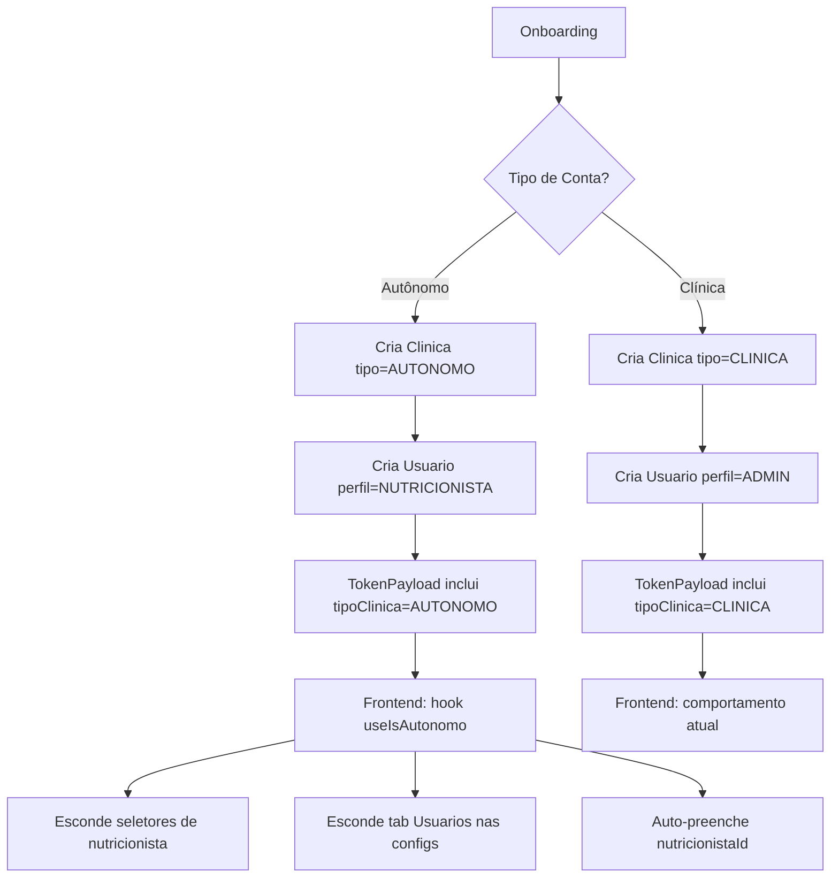

# Análise de Refatoração: Modo Autônomo vs Clínica

## Contexto do Problema

O NutriSaaS foi projetado como SaaS para **clínicas de nutrição** com múltiplos usuários (ADMIN, NUTRICIONISTA, SECRETÁRIA). Um nutricionista autônomo precisa:
1. Cadastrar uma "clínica" fictícia só para si
2. Criar um usuário ADMIN separado do seu perfil de nutricionista
3. Lidar com seletores de nutricionista que não fazem sentido quando ele é o único

O objetivo é que o sistema funcione igualmente bem para **autônomos** (1 pessoa faz tudo) e **clínicas** (múltiplos profissionais).

---

## Mapeamento Completo dos Pontos de Impacto

Analisei todo o projeto e identifiquei **todas** as áreas afetadas:

### 1. Modelo de Dados (Prisma Schema)

| Entidade | Campo Relevante | Impacto |
|----------|----------------|---------|
| `Clinica` | — | Precisa de um campo `tipo` (`AUTONOMO` / `CLINICA`) |
| `Usuario` | `perfil` (enum: ADMIN, NUTRICIONISTA, SECRETARIA) | No modo autônomo, o único usuário teria perfil unificado |
| `Agendamento` | `nutricionistaId`, `criadoPorUsuarioId` | Ambos apontam para o mesmo usuário no autônomo |
| `PlanoAlimentar` | `usuarioId` | Sempre o próprio usuário no autônomo |

### 2. Backend — Autenticação & Onboarding

| Arquivo | O que muda |
|---------|-----------|
| [clinica.schema.ts](file:///home/jeffson-luiz/Workspace/projetos/spark/nutrisass/packages/shared/src/schemas/clinica.schema.ts) | Schema de onboarding precisa de campo `tipo` |
| [clinica.controller.ts](file:///home/jeffson-luiz/Workspace/projetos/spark/nutrisass/apps/api/src/modules/clinica/infra/clinica.controller.ts) | Onboarding cria ADMIN no modo clínica, mas no autônomo cria perfil unificado |
| [login.usecase.ts](file:///home/jeffson-luiz/Workspace/projetos/spark/nutrisass/apps/api/src/modules/auth/application/login.usecase.ts) | TokenPayload precisa incluir `tipoClinica` |
| [TokenPayload](file:///home/jeffson-luiz/Workspace/projetos/spark/nutrisass/packages/shared/src/types/index.ts) | Adicionar `tipoClinica: 'AUTONOMO' \| 'CLINICA'` |

### 3. Backend — Serviços com Seletor de Nutricionista

| Arquivo | Comportamento Atual | Mudança Necessária |
|---------|--------------------|--------------------|
| [agenda.service.ts](file:///home/jeffson-luiz/Workspace/projetos/spark/nutrisass/apps/api/src/modules/agenda/infra/agenda.service.ts) | Filtra por `nutricionistaId` opcional | No autônomo, auto-preencher com o userId do token |
| [agenda.controller.ts](file:///home/jeffson-luiz/Workspace/projetos/spark/nutrisass/apps/api/src/modules/agenda/infra/agenda.controller.ts) | Lógica de perfil SECRETARIA vs NUTRICIONISTA | No autônomo, sempre usar o próprio userId |
| [usuarios.service.ts](file:///home/jeffson-luiz/Workspace/projetos/spark/nutrisass/apps/api/src/modules/usuarios/infra/usuarios.service.ts) | `pegarTodosNutricionistas()` lista nutricionistas | No autônomo, retorna lista com 1 elemento |
| [dashboard.service.ts](file:///home/jeffson-luiz/Workspace/projetos/spark/nutrisass/apps/api/src/modules/dashboard/infra/dashboard.service.ts) | Filtra por nutricionistaId opcional | No autônomo, auto-filtra |

### 4. Frontend — Páginas com Seletor/Filtro de Nutricionista

| Página | Elemento UI | O que esconder no modo autônomo |
|--------|------------|-------------------------------|
| [AgendaPage.tsx](file:///home/jeffson-luiz/Workspace/projetos/spark/nutrisass/apps/web/src/pages/Agenda/AgendaPage.tsx) | `<select>` de filtro por nutricionista (L194-206) | Esconder filtro inteiro |
| [AgendamentoModal.tsx](file:///home/jeffson-luiz/Workspace/projetos/spark/nutrisass/apps/web/src/pages/Agenda/components/AgendamentoModal.tsx) | `<select>` de nutricionista no formulário (L121-142) | Esconder campo, auto-preencher |
| [TabelaAgenda.tsx](file:///home/jeffson-luiz/Workspace/projetos/spark/nutrisass/apps/web/src/pages/Agenda/components/TabelaAgenda.tsx) | Coluna "Nutricionista" na tabela (L66, L90) | Esconder coluna |
| [DashboardPage.tsx](file:///home/jeffson-luiz/Workspace/projetos/spark/nutrisass/apps/web/src/pages/Dashboard/DashboardPage.tsx) | Filtro de nutricionista no header (L147-170); Badge de nome do nutricionista (L325-329) | Esconder filtro e badge |
| [RelatoriosPage.tsx](file:///home/jeffson-luiz/Workspace/projetos/spark/nutrisass/apps/web/src/pages/Relatorios/RelatoriosPage.tsx) | — (não tem filtro de nutri) | Sem mudança |

### 5. Frontend — Configurações & Usuários

| Página | Impacto no modo autônomo |
|--------|------------------------|
| [ConfigPage.tsx](file:///home/jeffson-luiz/Workspace/projetos/spark/nutrisass/apps/web/src/pages/Configuracoes/ConfigPage.tsx) | Tab "Usuários" não faz sentido — esconder ou simplificar |
| [UsuariosConfig.tsx](file:///home/jeffson-luiz/Workspace/projetos/spark/nutrisass/apps/web/src/pages/Configuracoes/Usuarios/UsuariosConfig.tsx) | CRUD de usuários não se aplica — esconder inteiro |
| [Sidebar.tsx](file:///home/jeffson-luiz/Workspace/projetos/spark/nutrisass/apps/web/src/components/Sidebar/Sidebar.tsx) | Mesmo menu, nenhuma mudança necessária |

### 6. Frontend — Onboarding

| Página | Mudança |
|--------|--------|
| [OnboardingPage.tsx](file:///home/jeffson-luiz/Workspace/projetos/spark/nutrisass/apps/web/src/pages/Onboarding/OnboardingPage.tsx) | Adicionar step inicial: "Autônomo ou Clínica?". No modo autônomo, ocultar campos de CNPJ e trocar texto "Cadastre sua clínica" → "Cadastre seu consultório" |

---

## Opções de Arquitetura

### Opção A: Campo `tipo` na tabela `Clinica` (⭐ Recomendada)

```prisma
enum TipoClinica {
  AUTONOMO
  CLINICA
}

model Clinica {
  // ... campos existentes
  tipo TipoClinica @default(CLINICA)
}
```

**Como funciona:**
- O campo `tipo` na `Clinica` determina o comportamento do sistema inteiro
- No onboarding **autônomo**: cria a Clínica com `tipo: AUTONOMO` e o usuário com `perfil: NUTRICIONISTA` (em vez de ADMIN)
- O `tipo` é propagado no `TokenPayload` e armazenado no frontend via `authStore`
- Cada componente do frontend checa `tipoClinica === 'AUTONOMO'` para esconder/simplificar elementos

**Vantagens:**
- ✅ Menor impacto no banco — apenas 1 campo novo + 1 enum
- ✅ Toda a lógica de decisão fica centralizada em 1 flag
- ✅ Migração de AUTONOMO → CLINICA é simples: alterar o campo e criar novos usuários
- ✅ A Clinica continua existindo como "contêiner de dados" (tenant), mesmo para autônomos
- ✅ Nenhuma tabela precisa ser reestruturada

**Desvantagens:**
- ⚠️ O conceito de "Clínica" fica semanticamente estranho para autônomos (mas pode ser rebatizado na UI como "Consultório" ou "Meu Espaço")

---

### Opção B: Eliminar Clinica para Autônomos (Duas arquiteturas paralelas)

Criar um fluxo totalmente separado onde autônomos não possuem Clinica — o `clinicaId` seria nullable.

**Vantagens:**
- ✅ Mais "correto" semanticamente

**Desvantagens:**
- ❌ **Enorme** impacto no código — `clinicaId` é `NOT NULL` em praticamente todas as tabelas (Paciente, Agendamento, Convenio, Questionario, Avaliacao, PlanoAlimentar, Alimento, ExameBase)
- ❌ Todos os services precisariam de lógica condicional para `clinicaId` nullable
- ❌ Complexidade de migração entre modos seria muito maior
- ❌ Risco alto de bugs e inconsistências

**Conclusão: ❌ Não recomendo.**

---

### Opção C: Perfil "AUTONOMO" no enum Perfil

Adicionar um quarto perfil: `AUTONOMO` que unifica ADMIN + NUTRICIONISTA.

**Vantagens:**
- ✅ Fácil de checar no código (`perfil === 'AUTONOMO'`)

**Desvantagens:**
- ❌ Mistura o conceito de "tipo de conta" com "papel do usuário"
- ❌ Todas as checagens de permissão `perfil === 'NUTRICIONISTA'` precisariam virar `perfil === 'NUTRICIONISTA' || perfil === 'AUTONOMO'`
- ❌ Migração de plano é mais complexa (mudar perfil de AUTONOMO para ADMIN e criar novo NUTRICIONISTA)

**Conclusão: ⚠️ Funcional, mas poluirá o código de permissões.**

---

## Recomendação Final: Opção A

### Resumo da Estratégia de Implementação



### Camadas de Mudança (Ordenadas por Dependência)

1. **Schema Prisma**: Adicionar enum `TipoClinica` + campo `tipo` em `Clinica`
2. **Shared Types**: Adicionar `tipoClinica` ao `TokenPayload` e ao `onboardingSchema`
3. **Backend Onboarding**: Bifurcar criação baseada no `tipo`
4. **Backend Auth**: Incluir `tipoClinica` no JWT
5. **Frontend Hook**: Criar `useIsAutonomo()` que lê do `authStore`
6. **Frontend Pages**: Aplicar condicionais usando o hook em ~6 componentes
7. **Migração de Plano**: Endpoint para alterar `Clinica.tipo` + ajustar perfis

### Sobre a Migração de Plano (Autônomo ↔ Clínica)

| Direção | O que acontece |
|---------|---------------|
| Autônomo → Clínica | O `Usuario` atual vira `ADMIN` + mantém acesso. Pode criar novos nutricionistas e secretárias |
| Clínica → Autônomo | Só permitir se houver apenas 1 usuário ativo. Muda `tipo` para `AUTONOMO`, perfil do usuário para `NUTRICIONISTA` |

---

## Perguntas Abertas para Decisão

> [!IMPORTANT]
> 1. **Terminologia na UI**: Para autônomos, devemos chamar de "Consultório", "Meu Espaço", ou manter "Clínica" mesmo?
> 2. **Convênios no autônomo**: Autônomos devem ter acesso ao módulo de convênios, ou seria apenas "Particular"?
> 3. **Questionários no autônomo**: Manter a mesma funcionalidade de questionários?
> 4. **Migração retroativa**: Existe alguma conta de teste/produção que já está no banco e precisaria ser migrada para o novo modelo?
