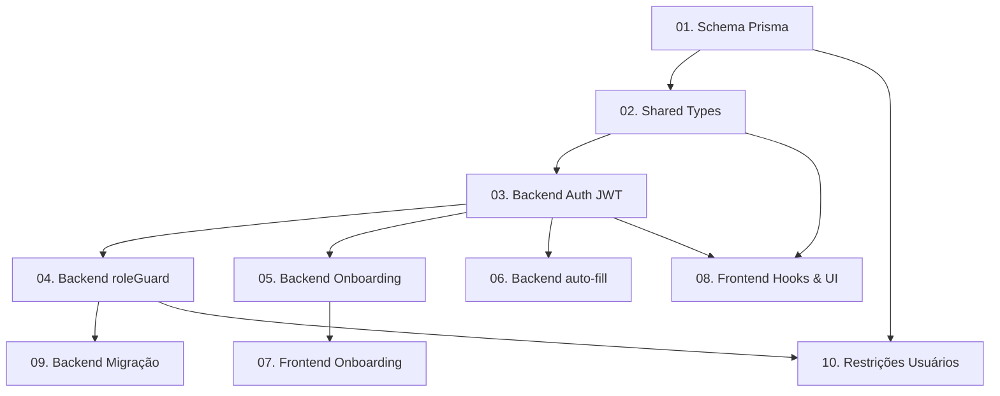

# Roadmap de Refatoração: Modo Autônomo e Clínica

Este documento descreve o roadmap ideal para a implementação da funcionalidade de alternância de modos (Autônomo vs. Clínica). Cada etapa do processo foi documentada individualmente e dividida em tarefas sequenciais dentro do diretório `docs/refact/tasks/`.

---

## 🗺️ Ordem de Implementação Recomendada

A ordem a seguir minimiza conflitos de merge e garante que cada etapa seja construída sobre dependências já validadas e testadas:

### 📋 Lista de Tarefas (Tasks)

| Ordem | Arquivo de Task | Componente | Descrição |
| :--- | :--- | :--- | :--- |
| **1** | [01-schema-prisma.md](file:///home/jeffson-luiz/Workspace/projetos/spark/nutrisass/docs/refact/tasks/01-schema-prisma.md) | Banco de Dados | Enum `TipoClinica` e campo `tipo` no model `Clinica`. |
| **2** | [02-shared-types.md](file:///home/jeffson-luiz/Workspace/projetos/spark/nutrisass/docs/refact/tasks/02-shared-types.md) | Shared Package | Atualização do `TokenPayload` e schema do Zod de onboarding. |
| **3** | [03-backend-auth-jwt.md](file:///home/jeffson-luiz/Workspace/projetos/spark/nutrisass/docs/refact/tasks/03-backend-auth-jwt.md) | Backend Auth | Injeção do `tipoClinica` no JWT durante login, refresh e endpoints internos. |
| **4** | [04-backend-roleguard.md](file:///home/jeffson-luiz/Workspace/projetos/spark/nutrisass/docs/refact/tasks/04-backend-roleguard.md) | Backend Middlewares | Bypass de permissões `roleGuard('ADMIN')` para o autônomo. |
| **5** | [05-backend-onboarding.md](file:///home/jeffson-luiz/Workspace/projetos/spark/nutrisass/docs/refact/tasks/05-backend-onboarding.md) | Backend Clinicas | Fluxo bifurcado no cadastro inicial de Clínica/Autônomo. |
| **6** | [06-backend-autofill.md](file:///home/jeffson-luiz/Workspace/projetos/spark/nutrisass/docs/refact/tasks/06-backend-autofill.md) | Backend Agenda/Dash | Segurança e filtros automáticos no backend. |
| **7** | [07-frontend-onboarding.md](file:///home/jeffson-luiz/Workspace/projetos/spark/nutrisass/docs/refact/tasks/07-frontend-onboarding.md) | Frontend Onboarding | Cards de seleção no onboarding para o usuário escolher o tipo de espaço. |
| **8** | [08-frontend-hook-pages.md](file:///home/jeffson-luiz/Workspace/projetos/spark/nutrisass/docs/refact/tasks/08-frontend-hook-pages.md) | Frontend UI | Criação do hook `useIsAutonomo` e adequações das telas principais. |
| **9** | [09-backend-migracao-plano.md](file:///home/jeffson-luiz/Workspace/projetos/spark/nutrisass/docs/refact/tasks/09-backend-migracao-plano.md) | Backend Planos | Endpoint transacional para alternância ativa do tipo de conta (AUTONOMO ↔ CLINICA). |
| **10**| [10-restricoes-usuarios.md](file:///home/jeffson-luiz/Workspace/projetos/spark/nutrisass/docs/refact/tasks/10-restricoes-usuarios.md) | Backend/Business | Impedir criação de novos usuários e deleção do único usuário no modo autônomo. |

---

## ⚡ Estratégia de Teste e Validação por Fase

### Fase 1: Fundação (Tasks 1, 2, 3 e 4)
* **Como testar:**
  1. Aplique a migração Prisma (`npx prisma migrate dev`).
  2. Suba o backend e faça login com uma conta de clínica existente. Verifique se o JWT gerado contém `tipoClinica: 'CLINICA'` (use jwt.io para inspecionar).
  3. Altere via banco o tipo de uma clínica para `AUTONOMO`, faça login e valide se o token é atualizado com `'AUTONOMO'`.

### Fase 2: Cadastro e Permissões (Tasks 5, 6 e 7)
* **Como testar:**
  1. Crie uma conta autônoma usando o novo fluxo de onboarding do frontend.
  2. Verifique na tabela `Usuario` se o seu perfil foi criado como `NUTRICIONISTA`.
  3. Verifique na tabela `Clinica` se o tipo foi criado como `AUTONOMO`.
  4. Tente acessar rotas que antes exigiam ADMIN (como CRUD de convênios). Valide se o bypass do `roleGuard` está concedendo acesso.

### Fase 3: Adaptabilidade Visual (Task 8)
* **Como testar:**
  1. Acesse o sistema como Autônomo e verifique visualmente se:
     - O seletor de nutricionista na agenda e no dashboard sumiu.
     - A aba de gerenciamento de usuários sumiu de configurações.
     - A coluna "Nutricionista" sumiu da tabela de consultas na Agenda.
  2. Acesse o sistema como Clínica (outro cadastro) e valide se todos os filtros e colunas ainda estão visíveis (garantia de regressão zero).

### Fase 4: Migração Transacional (Task 9)
* **Como testar:**
  1. Teste o endpoint `PUT /clinica/tipo` enviando payload para mudar de `AUTONOMO` para `CLINICA`.
  2. Verifique se o perfil mudou para `ADMIN` e se o token retornado já reflete o novo plano.
  3. Cadastre outros 2 usuários. Tente migrar de volta para `AUTONOMO` e valide que o backend bloqueou com a mensagem de validação de quantidade de usuários.
  4. Remova os usuários adicionados e verifique se a migração para `AUTONOMO` agora funciona.
