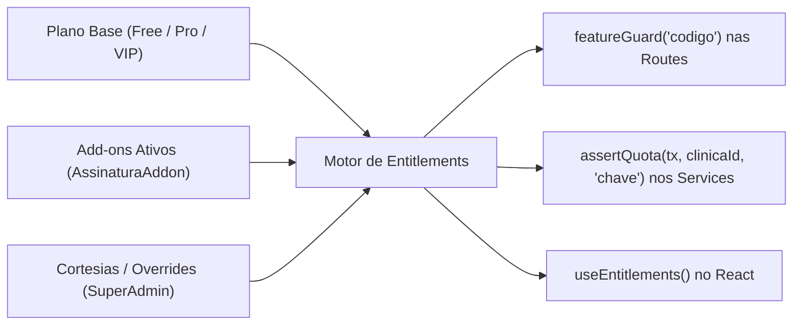
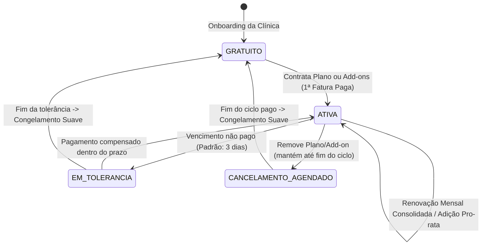
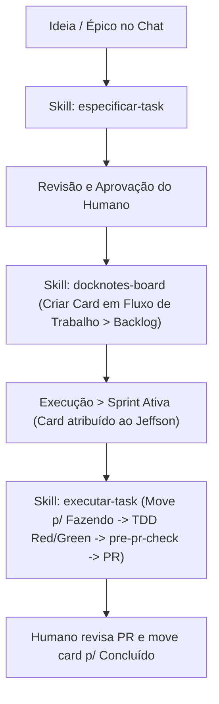

# NutriSaaS — Ordem de Guerra, Arquitetura Modular e Esteira de IA

Este documento consolida todas as decisões estratégicas, de produto, segurança e arquitetura definidas para transformar o **NutriSaaS** em um SaaS modular escalável, mantendo uma linha de produção de tarefas determinística para agentes de IA (**Antigravity** e **Claude Code**) integrada ao **DockNotes**.

---

## 1. Estratégia de Produto e Psicologia de Preços

### 1.1. Ancoragem Reversa ("Efeito Comprador Esperto")
Em vez de empurrar todos para um plano intermediário fixo, a vitrine utiliza **3 opções** onde o **Plano Completo / VIP** tem ticket propositalmente alto para servir de âncora de valor:
1. **Plano Personalizável (Começa em R$ 0/mês)**: Entrega toda a operação essencial de consultório gratuitamente e permite somar *Add-ons* sob demanda. A interface exibe em tempo real: *"Você está economizando R$ X/mês em relação ao Plano Completo!"*.
2. **Plano Completo (Pro)**: Destrava todas as cotas e módulos operacionais por um valor cheio único (para clínicas maiores que não querem escolher item a item). Se a soma de *Add-ons* escolhidos no Personalizável encostar no valor do Pro, o *Teto Inteligente* sugere a troca automática.
3. **Plano VIP / Premium (Âncora Superior)**: Tudo do Completo + diferenciais leves de atendimento (suporte prioritário via WhatsApp, onboarding/migração assistida, acesso antecipado a novas features/IA).

### 1.2. Matriz do Plano Gratuito vs. Add-ons

| Recurso / Módulo | No Plano Gratuito (R$ 0) | Modelo do Add-on Pago | Tipo Técnico |
| :--- | :--- | :--- | :--- |
| **Modo `AUTONOMO` / `CLINICA`** | Livre escolha na UI | — | Preferência de UX |
| **Pacientes Cadastrados** | **Ilimitados** | — | Livre (foco em adoção/dados) |
| **Consultas, Medidas, Evoluções, Planos de Paciente, Exames e Convênios/TISS** | **Ilimitados** | — | Livre (nunca trava consulta) |
| **Assentos Clínicos (`ADMIN` + `NUTRICIONISTA`)** | Até **1** profissional | Pacote multiplicável (ex.: `+5 profissionais` por `1x, 2x...`) | `QUOTA_PACK` (`max_profissionais_clinicos`) |
| **Assentos Administrativos (`SECRETARIA`)** | Até **1** secretária | Pacote multiplicável (ex.: `+5 secretárias` por `1x, 2x...`) | `QUOTA_PACK` (`max_secretarias`) |
| **Templates de Plano Alimentar (`isTemplate`)** | Até **2** modelos | Destrava **Templates Ilimitados** | `QUOTA_UNLIMITED` (`max_templates_plano`) |
| **Questionários Personalizados** | Até **1** (padrão do onboarding) | Destrava **Questionários Ilimitados** | `QUOTA_UNLIMITED` (`max_questionarios`) |
| **Meus Alimentos / Suplementos Próprios** | TACO livre + até **10** próprios | Destrava **Catálogo Próprio Ilimitado** | `QUOTA_UNLIMITED` (`max_alimentos_custom`) |
| **Relatórios Gerenciais** | Limitado aos **últimos 30 dias** | Destrava **Histórico Completo & Impressão** | `FEATURE_FLAG` (`relatorios_completos`) |
| **Módulos Futuros (`SAASN-36` Logo, `SAASN-163` Envio Medidas, Chatbot)** | Desativados (ou marca d'água NutriSaaS) | Vendidos individualmente como *Add-on* | `FEATURE_FLAG` |

---

## 2. Arquitetura Técnica dos 4 Pilares

### 2.1. Motor de *Entitlements* (Sem `if (plano === 'PRO')` espalhado)
O código de negócio **nunca** consulta o nome do plano; ele consulta o objeto calculado `ClinicaEntitlements` (cacheado no Redis em `entitlements:${clinicaId}` e invalidado em mudanças de assinatura/override):

- **Backend**:
  - Módulo novo em `apps/api/src/modules/assinaturas/` (não usar o nome `modulos`, que já pertence às seções de questionários em `apps/api/src/modules/modulos/infra/modulos.routes.ts`).
  - `featureGuard(featureKey)` em `apps/api/src/shared/middlewares/featureGuard.ts`: retorna `402` (`code: 'FEATURE_LOCKED'`) quando a feature não está habilitada.
  - `assertQuota(tx, clinicaId, quotaKey, currentCount)` dentro de `$transaction` nos `*.service.ts`: retorna `402` (`code: 'QUOTA_EXCEEDED'`) quando `currentCount >= limit`.

### 2.2. Máquina de Estados da Assinatura, Cobrança Consolidada e Tolerância

1. **Fatura Única Mensal Consolidada**: Todos os *add-ons* ativos da clínica compõem uma única fatura mensal (`Fatura` + `FaturaItem`), evitando perda de margem com taxas por transação em itens baratos.
2. **Alteração no Meio do Ciclo**:
   - **Adição de Add-on**: Cobra imediatamente apenas o valor proporcional (*pro-rata*) dos dias restantes até o próximo vencimento e libera na confirmação.
   - **Remoção de Add-on**: Marca `removerNoFimDoCiclo = true`, mantendo o benefício até o fim do período já pago e retirando-o da fatura seguinte.
3. **Tolerância e Congelamento Suave (Sem Perda de Dados / Conformidade CFN)**:
   - Ao atrasar o pagamento, a assinatura entra em `EM_TOLERANCIA` por **3 dias** (configurável), exibindo banner de aviso ao `ADMIN` da clínica.
   - Esgotado o prazo sem pagamento, aplica-se o downgrade automático para o Gratuito:
     - **Usuários excedentes**: Novo campo `Usuario.ativo = false` nos usuários além de `1 clínico + 1 secretária` (mantendo o proprietário ativo e preservando 100% do histórico em `Agendamento` e `PlanoAlimentar`).
     - **Templates, Questionários e Alimentos já criados**: Permanecem disponíveis para leitura/uso, bloqueando apenas **novas criações** até caber na cota ou reativar o *add-on*.
4. **Gateway Desacoplado (`PaymentProvider`)**: Porta agnóstica pronta para receber **Asaas** ou **Stripe** na Fase 4, permitindo operar desde a Fase 3 via ativação/cortesia no Super Admin.

### 2.3. Modelagem de Banco de Dados Prevista (`schema.prisma`)
- Alteração em `Usuario`: adicionar `ativo Boolean @default(true)`.
- Novas tabelas de Assinatura/Catálogo:
  - `Plano` (`id`, `codigo`, `nome`, `descricao`, `precoCentavos`, `ordemExibicao`, `destaqueAncora`, `quotasJson`, `featuresJson`, `ativo`)
  - `Addon` (`id`, `codigo`, `nome`, `descricao`, `precoCentavos`, `multiplicavel`, `efeitoJson`, `ativo`)
  - `AssinaturaClinica` (`id`, `clinicaId @unique`, `planoId`, `precoContratadoCentavos`, `status`, `diaVencimento`, `inicioCicloAtual`, `fimCicloAtual`, `toleranciaAte`, `gatewayProvider`, `gatewayCustomerId`, `gatewaySubscriptionId`)
  - `AssinaturaAddon` (`id`, `assinaturaId`, `addonId`, `quantidade`, `precoUnitarioContratadoCentavos`, `removerNoFimDoCiclo`)
  - `ClinicaEntitlementOverride` (`id`, `clinicaId`, `quotasOverrideJson`, `featuresOverrideJson`, `motivo`, `validoAte`, `criadoPorSuperAdminId`)
  - `Fatura` e `FaturaItem` (histórico detalhado linha a linha para o `ADMIN` da clínica)
- Novas tabelas de Backoffice:
  - `SuperAdmin` (`id`, `nome`, `email @unique`, `senha`, `ativo`, `criadoEm`)
  - `BackofficeAuditLog` (`id`, `superAdminId`, `acao`, `alvoTipo`, `alvoId`, `detalhesJson`, `ip`, `criadoEm`)

### 2.4. Painel Super Admin (`/backoffice`) e Fronteira LGPD
- **Backend (`/api/backoffice/*`)**: Módulo isolado em `apps/api/src/modules/backoffice/`, autenticado com `JWT_BACKOFFICE_SECRET` e claim obrigatória `aud: 'backoffice'` (tokens normais de `Usuario` são rejeitados na entrada). Toda mutação grava `BackofficeAuditLog`.
- **Frontend (`/backoffice/*`)**: Rotas *lazy-loaded* (`React.lazy`) dentro de `apps/web`, com store de autenticação isolada (`backofficeAuthStore`), reaproveitando o design system sem pesar o bundle das clínicas.
- **Blindagem LGPD/CFN**: Endpoints do `/api/backoffice` retornam apenas **contadores agregados** (`_count` de pacientes, agendamentos, planos, templates e usuários) e dados cadastrais/financeiros da clínica — **jamais** retornam prontuários, evoluções, medidas, exames ou dietas nominais de pacientes.
- **Grandfathering de Preços**: Editar o preço de um `Plano` ou `Addon` no `/backoffice` afeta apenas novas contratações; assinaturas ativas preservam `precoContratadoCentavos` / `precoUnitarioContratadoCentavos` até migração explícita.

---

## 3. Engenharia de IA e Linha de Produção no DockNotes

### 3.1. Blindagem das Rules Existentes (`.agents/rules/02-regras-negocio-seguranca.md`)
As seguintes regras passam a ser obrigatórias para qualquer agente:
1. **Validação de FKs Secundárias do Payload**: Todo ID recebido em `req.body` (`nutricionistaId`, `convenioId`, `pacienteId`, `alimentoId`, `medidaCaseiraId`, `perguntaId`, `exameBaseId`) deve ter pertença comprovada à `clinicaId` (ou `clinicaId: null` para itens globais TACO) antes de salvar.
2. **Matriz RBAC Explícita**:
   - `SECRETARIA` em `CLINICA`: bloqueada em rotas clínicas (`clinicalGuard`) **e** bloqueada em rotas de gestão (`usuarios`, edição de `clinica`, `assinaturas`, CRUD de `alimentos`, CRUD de `convenios`).
   - `Clinica.ativa === false` ou `Usuario.ativo === false`: bloqueados no login, no refresh token e na validação de sessão.
3. **Proibição de Mutação sem Zod**: Toda rota `POST`, `PUT` ou `PATCH` com payload deve passar por `validate(schema)` (auditado via `grep` no `pre-pr-check`).
4. **Checklist de Cota/Feature**: Todo novo recurso deve declarar explicitamente se exige `featureGuard` ou `assertQuota`.

### 3.2. Novas Skills em `.agents/skills/`

1. **`.agents/skills/especificar-task/SKILL.md`**:
   - Quebra qualquer feature/correção em tasks atômicas (1 PR por task) com o **Contrato de Task Mastigada**:
     - Objetivo em 1 parágrafo
     - Escopo fechado de arquivos permitidos
     - Alterações exatas em `schema.prisma` e `@nutricao/shared`
     - Matriz de Segurança da Task (`Perfis permitidos`, `FKs validadas por clinicaId`, `featureGuard/assertQuota`)
     - Lista literal dos cenários `it('deve...')` para TDD (`200/201`, `400 Zod`, `402 Quota/Feature`, `403 Role`, `404 Cross-Tenant`)
2. **`.agents/skills/docknotes-board/SKILL.md`**:
   - Usa o subagente `browser` conectado ao Chrome do desenvolvedor:
   - **Criar Card**: Navega em `Fluxo de trabalho > Backlog` → clica em `Nova Tarefa` (canto superior direito) → preenche no modal `Novo Item`: Título, Categoria (`Tarefa`, `Bug`, `Teste`, `Spike`, `Hotfix`, `Épico`, `História`, `Débito Técnico`), Descrição Markdown mastigada, Prioridade, Datas de Início/Entrega, Participantes e Responsáveis (Código: **Jeffson** / **Kevin**; Infra/Servidor/Gateway externo: **Talles**).
   - **Ler e Iniciar Card**: Navega em `EXECUÇÃO > Sprint Ativa` → abre o card para ler o Drawer → **verifica obrigatoriamente se `Jeffson Luiz Oliveira de Lima Santos` está em `Responsáveis`** (recusando execução caso seja exclusivo de outro membro sem ordem explícita) → altera o `Status` para **`Fazendo`** ao iniciar. **Nunca** altera para `Concluído` (ação exclusiva do humano).
3. **`.agents/skills/executar-task/SKILL.md`**:
   - Orquestra o ciclo ponta a ponta: lê a issue via `docknotes-board` (e move para `Fazendo`) → cria branch GitFlow a partir da `develop` → executa TDD (`Red → Green → Refactor`) → roda `pre-pr-check` → entrega a descrição do PR via `gerar-descricao-pr`.

---

## 4. Ordem de Guerra (Sequência de Fases)

> [!IMPORTANT]
> No DockNotes já existem o épico **`SAASN-84`** (*[F6] Planos de Assinatura + Pagamentos*) com as sub-tasks `SAASN-85`, `SAASN-86` e `SAASN-87`, além da fila de auditoria **`SAASN-171` a `SAASN-190`**. Reaproveitaremos e refinaremos esses cards existentes em vez de duplicá-los.

### Fase 0 — Blindagem de IA & Fechamento de Brechas de Segurança
1. **Passo 0.1**: Atualizar `.agents/rules/02-regras-negocio-seguranca.md`, `AGENTS.md`, `CLAUDE.md`, `criar-modulo-api` e `pre-pr-check`, e criar as 3 novas skills (`especificar-task`, `docknotes-board`, `executar-task`).
2. **Passo 0.2**: Executar na esteira os cards de segurança/qualidade atribuídos ao Jeffson (`SAASN-171` a `SAASN-190` — autenticação de `Clinica.ativa`, refresh token, RBAC de `SECRETARIA`, IDORs em FKs, validação Zod em `PUT`, `errorHandler` Prisma e máscaras/forms do Web) + adicionar campo `Usuario.ativo`.

### Fase 1 — Fundação do Motor de *Entitlements* (`SAASN-85` expandido)
1. Migration Prisma com `Plano`, `Addon`, `AssinaturaClinica`, `AssinaturaAddon`, `ClinicaEntitlementOverride`, `Fatura` e `FaturaItem` + *seed* dos 3 Planos (`Personalizável`, `Pro Completo`, `VIP Âncora`) e dos *Add-ons* iniciais.
2. Backfill automático atribuindo assinatura `GRATUITO` a todas as clínicas existentes e integrando criação da assinatura padrão no `realizarOnboardingClinica`.
3. Implementação do `entitlements.service.ts` (cálculo Base + Add-ons + Overrides + cache Redis + máquina de estados com `EM_TOLERANCIA` de 3 dias e downgrade suave) + middlewares `featureGuard` e `assertQuota`.
4. Endpoint `GET /api/assinaturas/meus-limites` + hook `useEntitlements()` no `apps/web`.

### Fase 2 — Travas nos Módulos Existentes & Vitrine "Monte seu Plano" (`SAASN-87`)
1. Aplicar `assertQuota` em `usuarios` (`1 clínico + 1 secretária`), `planos-alimentares` (`2 templates`), `questionarios` (`1 questionário`) e `alimentos` (`10 customizados`), e `featureGuard` / filtro de 30 dias em `relatorios`.
2. Construir a aba/página **Meu Plano & Assinatura** em Configurações com o construtor interativo de *Add-ons*, cálculo de economia em tempo real contra a âncora (*"Você economiza R$ X/mês"*), *Teto Inteligente* e modal global de upgrade ao bater em HTTP `402`.

### Fase 3 — Painel Super Admin (`/backoffice`)
1. Backend `/api/backoffice/*` com `SuperAdmin` isolado, JWT dedicado, `BackofficeAuditLog` e zero exposição de prontuários (LGPD).
2. Frontend `/backoffice/*` (*lazy-loaded*): Dashboard de métricas agregadas/MRR, listagem e ativação/suspensão de clínicas e usuários, editor de catálogo de Planos/Add-ons (com *grandfathering*) e concessão de Cortesias/Overrides manuais.

### Fase 4 — Gateway de Pagamento Consolidado (`SAASN-86`), Analytics e Novos Add-ons
1. Adaptador `PaymentProvider` (Asaas ou Stripe) com webhooks assinados, geração de fatura mensal consolidada, cálculo *pro-rata* na adição de *add-on* e agendamento de remoção no fim do ciclo.
2. Job diário de verificação de vencimentos (`ATIVA → EM_TOLERANCIA (3 dias) → GRATUITO` com congelamento suave e aviso no painel).
3. Integração do Microsoft Clarity (modo *Strict* LGPD) e entrada de novos módulos pagos como *Add-ons* (`SAASN-36` Logo/Identidade, `SAASN-163` Envio de medidas, Chatbot).
