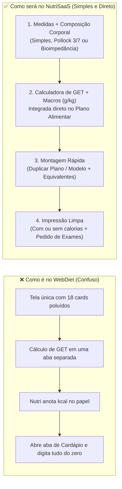

# Diagnóstico Estratégico e Plano de Evolução: NutriSaaS vs. WebDiet

## 1. Contexto e Objetivo

Você validou o **NutriSaaS** com nutricionistas reais do mercado e descobriu uma oportunidade clara de produto:
1. **A dor com o WebDiet:** Ele é o líder porque "tem tudo", mas **é caro e visualmente caótico** (dezenas de blocos simultâneos, siglas confusas, excesso de cliques e baixa legibilidade, o que afasta especialmente profissionais mais experientes ou de mais idade).
2. **A barreira de adoção do NutriSaaS hoje:** Os profissionais gostaram da limpeza visual do seu sistema, mas **não conseguem migrar ainda porque faltam os cálculos nutricionais obrigatórios** do dia a dia clínico (Gasto Energético, distribuição de macros por g/kg, % de Gordura Corporal por dobras/bioimpedância e atalhos de produtividade no cardápio), além de existirem alguns **bugs matemáticos no código atual** que quebrariam a confiança durante uma consulta.

Este documento entrega:
- **Parte 1:** O que está **errado ou quebrado hoje** no código do NutriSaaS (e que deixaria o sistema inutilizável na prática).
- **Parte 2:** Comparativo direto **WebDiet vs. NutriSaaS** (o que falta de essencial nos cálculos e no fluxo de trabalho).
- **Parte 3:** Como superar o WebDiet em **Usabilidade (UX Sênior-Friendly)** sem perder poder clínico.
- **Parte 4:** **Plano Técnico de Implementação (Roadmap MVP Clínico)** dividido em fases para você aprovar e executarmos.

---

## 2. Parte 1 — O Que Pode Estar Errado Hoje no NutriSaaS (Riscos Críticos de Inutilização)

Analisando o código-fonte atual (`apps/web` e `apps/api`), identifiquei **6 problemas críticos** que fariam um nutricionista abandonar o sistema no meio do primeiro atendimento:

> [!CAUTION]
> **Bug Crítico #1: Erro matemático grave no cálculo de Medidas Caseiras e na Edição do Plano Alimentar**
> No arquivo [PlanoAlimentarBuilder.tsx](file:///home/jeffson/Documentos/projetos/work/spark/nutrisass/apps/web/src/pages/Pacientes/Prontuario/components/PlanoAlimentarBuilder.tsx), existem três falhas encadeadas no cálculo de calorias e macronutrientes:
> 1. **Editar plano salvo zera o recálculo ([linhas 160-175](file:///home/jeffson/Documentos/projetos/work/spark/nutrisass/apps/web/src/pages/Pacientes/Prontuario/components/PlanoAlimentarBuilder.tsx#L160-L175)):** Quando o nutricionista abre um plano existente para editar (`initialData`), a propriedade `_basePer100` de todos os alimentos é inicializada fixa como `{ cal: 0, prot: 0, carb: 0, gord: 0 }` (ignorando `a.alimentoRel`). Se o nutricionista mudar a quantidade de um alimento já salvo, **as calorias e macros não mudam**.
> 2. **Mudar quantidade com Medida Caseira calcula como se fosse 1 grama ([linhas 337-357](file:///home/jeffson/Documentos/projetos/work/spark/nutrisass/apps/web/src/pages/Pacientes/Prontuario/components/PlanoAlimentarBuilder.tsx#L337-L357)):** Na função `updateAlimento`, se o alimento já estiver com uma medida caseira selecionada (ex: *"Colher de sopa cheia"* = 25g) e o nutricionista alterar a quantidade de `1` para `2`, o `if (field === "medidaCaseiraId" && value)` dá falso e o `else if (field === "quantidade" && !updated.medidaCaseiraId)` também dá falso. O sistema passa `qtdG = 2` (2 gramas!) em vez de `2 × 25g = 50g`.
> 3. **Explosão de 100 unidades ao trocar de gramas para medida caseira ([linha 269](file:///home/jeffson/Documentos/projetos/work/spark/nutrisass/apps/web/src/pages/Pacientes/Prontuario/components/PlanoAlimentarBuilder.tsx#L269)):** Todo alimento entra com `quantidade: 100` (100g). Quando o nutricionista muda o select de `g` para `Unidade média (50g)`, o sistema calcula `100 × 50g = 5.000g` (100 ovos!) porque não reseta a quantidade para `1`, e quando ele digita `1`, cai no bug #2 acima e calcula 1 grama de ovo. Além disso, se voltar o select para `g`, o campo `unidade` continua salvo com o nome da medida anterior.

> [!WARNING]
> **Problema Clínico #2: Divergência entre o Total Diário da Tela e o PDF (e exposição forçada de calorias ao paciente)**
> - Na tela ([PlanoAlimentarBuilder.tsx](file:///home/jeffson/Documentos/projetos/work/spark/nutrisass/apps/web/src/pages/Pacientes/Prontuario/components/PlanoAlimentarBuilder.tsx#L385-L401) e [PlanoAlimentarView.tsx](file:///home/jeffson/Documentos/projetos/work/spark/nutrisass/apps/web/src/pages/Pacientes/Prontuario/components/PlanoAlimentarView.tsx#L37-L51)), o sistema soma apenas a **Opção 1 (`opcoes[0]`)** de cada refeição.
> - Já no PDF entregue ao paciente ([PlanoAlimentarPdfPage.tsx](file:///home/jeffson/Documentos/projetos/work/spark/nutrisass/apps/web/src/pages/Pacientes/Prontuario/PlanoAlimentarPdfPage.tsx#L46-L70)), o sistema calcula a **média de todas as opções** e estampa um bloco verde gigante com Calorias e Macros no documento.
> - **Por que isso trava o uso:** Primeiro, o valor planejado pelo nutricionista não bate com o impresso. Segundo, na nutrição clínica comportamental e emagrecimento, **a maioria dos nutricionistas NÃO quer que o paciente veja a contagem calórica no PDF** para não gerar ansiedade (no WebDiet isso é um botão opcional antes de imprimir).

> [!IMPORTANT]
> **Problema de Fluxo #3: Aba de Medidas "Cega" na Tela e Sem Botão de Edição**
> - Em [MedidasTab.tsx](file:///home/jeffson/Documentos/projetos/work/spark/nutrisass/apps/web/src/pages/Pacientes/Prontuario/components/MedidasTab.tsx), a tabela mostra apenas os 10 números digitados. **O IMC e a variação de peso só existem na folha de impressão** ([imprimirMedidas.ts](file:///home/jeffson/Documentos/projetos/work/spark/nutrisass/apps/web/src/pages/Pacientes/Prontuario/print/imprimirMedidas.ts#L36-L49)). Durante a consulta, o nutricionista não vê na tela nem o IMC, nem a relação cintura-quadril, nem quanto o paciente perdeu/ganhou desde a última consulta.
> - Além disso, **não existe edição de medida** (nem no front nem no [prontuario.controller.ts](file:///home/jeffson/Documentos/projetos/work/spark/nutrisass/apps/api/src/modules/prontuario/infra/prontuario.controller.ts#L57-L101)): se errar um dígito ao salvar, o profissional é obrigado a excluir a avaliação inteira e redigitar tudo.

- **Problema #4 — Solicitação de Exames sem Impressão de Pedido:** Em [ExamesTab.tsx](file:///home/jeffson/Documentos/projetos/work/spark/nutrisass/apps/web/src/pages/Pacientes/Prontuario/components/ExamesTab.tsx), o nutricionista seleciona os exames e clica em "Solicitar", mas **não existe botão para Imprimir o Pedido de Exames (PDF timbrado)** para entregar ao paciente levar ao laboratório, nem alerta visual (Vermelho/Verde) comparando o resultado lançado com o `valorMinimo` e `valorMaximo` já existentes no banco ([schema.prisma](file:///home/jeffson/Documentos/projetos/work/spark/nutrisass/apps/api/prisma/schema.prisma#L323-L339)).
- **Problema #5 — Evolução Clínica junta todas as consultas num texto só sem data:** Em [EstadoClinicoTimeline.tsx](file:///home/jeffson/Documentos/projetos/work/spark/nutrisass/apps/web/src/pages/Pacientes/Prontuario/components/EstadoClinicoTimeline.tsx#L83-L92), o sistema faz `.join('\n')` de todas as evoluções passadas sem exibir a data de cada registro e sem permitir editar uma evolução caso o profissional esqueça de anotar algo.
- **Problema #6 — Falta do CRN do Nutricionista:** O model `Usuario` ([schema.prisma](file:///home/jeffson/Documentos/projetos/work/spark/nutrisass/apps/api/prisma/schema.prisma#L76-L92)) não possui campo `crn`. Pelo Conselho Federal de Nutricionistas (CFN), todo cardápio, pedido de exame e laudo antropométrico impresso exige o número do CRN abaixo da assinatura.

---

## 3. Parte 2 — Comparativo WebDiet vs. NutriSaaS: O Que Falta (Os Cálculos Obrigatórios)

Quando os nutricionistas disseram que **"faltam cálculos importantes"**, eles estavam se referindo diretamente aos **3 motores de cálculo** abaixo que todo nutricionista usa em 100% das consultas no WebDiet:

| Pilar Clínico / Funcionalidade | Como funciona no WebDiet | Como está hoje no NutriSaaS | Impacto para o Nutricionista |
| :--- | :--- | :--- | :--- |
| **1. Cálculo de TMB e GET (Gasto Energético)** | Calcula TMB e GET automaticamente por **Mifflin-St Jeor**, **Harris-Benedict**, **FAO/OMS**, **Cunningham/Tinsley** e **Fórmula de Bolso (kcal/kg)** + Fator Atividade (NAF). | ❌ **Inexistente.** O nutri precisa calcular na calculadora/Excel e digitar a meta calórica na mão. | 🔴 **Bloqueante** (Motivo #1 pelo qual não conseguem migrar). |
| **2. Planejamento de Macros por `g/kg` e `%`** | Define Proteína, Carboidrato e Gordura digitando **`g/kg de peso`** (ex: `2.0 g/kg` de proteína) ou `% do VET`, convertendo sozinho para gramas totais e kcal. | ❌ **Inexistente.** Só aceita digitar o total absoluto em gramas (`metaProteinas`, etc.). | 🔴 **Bloqueante** (Todo nutricionista prescreve macros em `g/kg`). |
| **3. Composição Corporal (% Gordura / Massa Magra)** | Calcula **% de Gordura, Massa Gorda (kg) e Massa Magra (kg)** via **Dobras Cutâneas** (Pollock 3 e 7 dobras, Guedes, Faulkner) ou **Bioimpedância** direta. | ❌ **Inexistente.** Só tem Peso, Altura e 8 circunferências em [Medida](file:///home/jeffson/Documentos/projetos/work/spark/nutrisass/apps/api/prisma/schema.prisma#L197-L216). | 🔴 **Bloqueante** (Sem % de gordura e massa magra, o nutri não avalia evolução real). |
| **4. Índices Antropométricos e Peso Ideal** | Calcula **IMC** (Adulto OMS e Idoso Lipschitz), **RCQ** (Cintura/Quadril), **RCE** (Cintura/Estatura), **Faixa de Peso Ideal** e **Circ. Muscular do Braço**. | ⚠️ **Parcial.** Só calcula IMC de adulto e **apenas no PDF impresso**, invisível na tela. | 🟠 **Alto** (Os dados já são coletados, falta apenas calcular e mostrar na tela!). |
| **5. Clonar / Modelos de Plano Alimentar** | Permite **Duplicar um plano anterior** do paciente (para retorno) ou puxar um **Cardápio Modelo** pré-pronto de 1500/1800/2000 kcal. | ❌ **Inexistente.** Todo plano precisa ser criado do zero refeição por refeição. | 🔴 **Bloqueante para Retornos** (Ninguém monta dieta do zero em consulta de retorno). |
| **6. Fibras e Equivalentes (Substituição)** | Soma Fibras e Micronutrientes da TACO; calcula **Lista de Substituição automática** por equivalência calórica/grupo. | ⚠️ **Parcial.** O banco tem `fibra` em [Alimento](file:///home/jeffson/Documentos/projetos/work/spark/nutrisass/apps/api/prisma/schema.prisma#L455), mas o Builder ignora; tem abas de Opções, mas sem equivalência automática. | 🟠 **Alto** (Exibir Fibras já está 80% pronto no banco). |
| **7. Prescrição de Suplementos / Receituário** | Aba de prescrição de suplementos, manipulados e fitoterápicos com impressão de receita em PDF. | ❌ **Inexistente.** | 🟡 **Médio/Alto** (Muito usado em consultório particular). |
| **8. Pedido de Exames Impresso + Alertas** | Imprime o pedido de exames timbrado e sinaliza resultados fora da referência laboratorial. | ⚠️ **Parcial.** Solicita e lança resultados, mas não imprime o pedido nem destaca alterados. | 🟠 **Alto** (Fácil de completar com a estrutura atual). |
| **9. QRM (Rastreamento Metabólico) e Guia TISS** | Tem QRM; **não tem foco forte em Guia TISS/Convênios** como sistemas médicos. | ✅ **Excelente!** QRM com link público + evolução e emissão de Guia TISS oficial. | 🟢 **Diferencial do NutriSaaS!** (Supera o WebDiet no atendimento por convênio). |

---

## 4. Parte 3 — Estratégia de UX: Como Bater o WebDiet Sendo Muito Mais Fácil (Foco em Todas as Idades)

O segredo para conquistar tanto o nutricionista jovem (que quer velocidade) quanto o nutricionista mais velho (que acha o WebDiet um labirinto) é aplicar **3 princípios de design**:

1. **Zero "Navegação Cega" entre Telas para Planejar a Dieta:**
   - Em vez de criar uma tela isolada de "Gasto Energético" onde o nutricionista calcula e depois esquece o número ao ir para o Plano Alimentar, teremos um **Assistente de Cálculo Energético e Macros (`g/kg`) embutido no topo do `PlanoAlimentarBuilder`** (e também visível no resumo de Medidas).
   - Ele já lê automaticamente o **último Peso, Altura, Idade e Sexo** do paciente. O nutricionista só escolhe a fórmula (*Mifflin-St Jeor*, *Harris-Benedict*, *FAO/OMS*, *Cunningham* ou *kcal/kg*), escolhe o Fator de Atividade, ajusta os sliders/campos de `g/kg` de Proteína, Carboidrato e Gordura, e clica em **"Aplicar às Metas do Plano"**.
2. **Avaliação Corporal em 3 Modos Claros (Sem Poluição Visual):**
   - Na aba `Medidas`, o formulário terá um seletor limpo com letras grandes:
     - **Básico (Circunferências + IMC/RCQ):** Apenas o que já existe hoje + panturrilha/pescoço, mas exibindo **na tela** um painel lateral/superior com IMC, Faixa de Peso Ideal, RCQ (Risco Cardiovascular) e RCE.
     - **Dobras Cutâneas (Pollock 3 ou Pollock 7):** Exibe apenas as 3 dobras (ex: Tríceps, Supra-ilíaca, Coxa) ou 7 dobras e já calcula na hora **% de Gordura, Massa Magra (kg) e Massa Gorda (kg)**.
     - **Bioimpedância:** Para quem tem balança digital e só quer digitar `% de Gordura`, `Massa Magra (kg)` e `% Água`/`Gordura Visceral`.
3. **Botões de Agilidade Extrema ("1-Clique"):**
   - **"Duplicar Plano"**: Na lista de planos do paciente, botão para clonar o plano da consulta passada e apenas ajustar quantidades.
   - **"Usar Refeições Padrão"**: Ao criar um novo plano, opção de já iniciar com as 5 ou 6 refeições clássicas criadas (*Café da Manhã 08:00, Colação 10:00, Almoço 12:30, Lanche da Tarde 16:00, Jantar 19:30*) em vez de clicar 6 vezes em "Adicionar Refeição" e digitar todos os nomes.
   - **Auto-Save no `localStorage`**: Rascunho automático do plano alimentar para nunca perder dados se fechar a aba sem querer.

---

## 5. Parte 4 — Plano Técnico de Implementação Proposto

Abaixo está o detalhamento técnico das alterações propostas no código do **NutriSaaS** para resolver os bugs atuais e entregar as funcionalidades essenciais.

## User Review Required

> [!IMPORTANT]
> **Decisões de Produto para sua Validação:**
> 1. **Ordem de Execução:** Abaixo estruturei a evolução em **4 Fases Lógicas** (Fase 1: Correção de Bugs Críticos + Calculadora GET/Macros `g/kg` + Atalhos de Plano Alimentar; Fase 2: Composição Corporal Pollock 3/7 + Bioimpedância + Índices na tela; Fase 3: Impressão de Pedido de Exames + Alertas de Referência + CRN; Fase 4: Modelos de Cardápio e Lista de Substituição). Você prefere que a gente já implemente a **Fase 1 e Fase 2 completas agora**, ou quer começar apenas pela Fase 1?
> 2. **Exibição de Calorias no PDF do Paciente:** Podemos colocar um seletor simples no [PlanoAlimentarPdfPage.tsx](file:///home/jeffson/Documentos/projetos/work/spark/nutrisass/apps/web/src/pages/Pacientes/Prontuario/PlanoAlimentarPdfPage.tsx) (`[x] Mostrar resumo de calorias e macronutrientes no PDF`) desmarcado ou marcado por padrão, e corrigir o cálculo para refletir a Opção Principal (ou permitir alternar)?

---

## Proposed Changes

### Fase 1: Correção dos Bugs do Plano Alimentar + Calculadora de GET/TMB e Macros (`g/kg`) + Produtividade

#### [NEW] [nutricaoCalculos.ts](file:///home/jeffson/Documentos/projetos/work/spark/nutrisass/apps/web/src/utils/nutricaoCalculos.ts)
Criar utilitário puro e testável com todas as fórmulas clínicas:
- **TMB / GEB:**
  - `Mifflin-St Jeor (1990)` (Homens e Mulheres)
  - `Harris-Benedict (1919)` (Homens e Mulheres)
  - `FAO/OMS (1985)` (por faixa etária e sexo)
  - `Cunningham (1980)` (baseada em Massa Livre de Gordura, quando disponível)
  - `Fórmula de Bolso (kcal/kg)` (ex: 20, 25, 30, 35 kcal/kg)
- **GET (Gasto Energético Total):** Multiplicadores de Fator de Atividade (`1.2` Sedentário a `1.9` Muito Intenso) + Delta de Objetivo (Déficit/Superávit em kcal).
- **Distribuição de Macronutrientes (`g/kg` e `% VET`):**
  - Conversão bidirecional: digitar `g/kg` de Proteína/Gordura/Carboidrato calcula imediatamente `gramas totais`, `kcal` (`Prot × 4`, `Carb × 4`, `Gord × 9`) e `% do VET` (com botão *"Completar restante com Carboidratos"*).
- **Hidratação:** Cálculo automático de `35 ml × Peso (kg)` (ajustável de 30 a 50 ml/kg).
- **Antropometria e Composição Corporal:**
  - `IMC` + Classificação diferenciada para **Adultos (< 60 anos, OMS)** e **Idosos (≥ 60 anos, Lipschitz/OPAS)**.
  - **Faixa de Peso Ideal** (IMC 18.5–24.9 para adultos ou 22–27 para idosos).
  - **RCQ (Relação Cintura-Quadril)** e **RCE (Relação Cintura-Estatura)** com classificação de risco cardiovascular.
  - **Pollock 3 Dobras** e **Pollock 7 Dobras** (Densidade Corporal + Equação de Siri → `% Gordura`, `Massa Gorda kg`, `Massa Magra kg`, classificação do % de gordura por sexo e idade).

#### [MODIFY] [PlanoAlimentarBuilder.tsx](file:///home/jeffson/Documentos/projetos/work/spark/nutrisass/apps/web/src/pages/Pacientes/Prontuario/components/PlanoAlimentarBuilder.tsx)
1. **Corrigir Bug de Edição (`_basePer100`):** Ao carregar `initialData`, extrair `_basePer100` de `a.alimentoRel` (ou deduzir proporcionalmente dos valores salvos caso seja alimento livre), garantindo que alterar quantidades na edição recalcule todos os macros e fibras.
2. **Corrigir Bug de Medida Caseira × Quantidade:**
   - Quando o usuário selecionar uma `medidaCaseiraId` pela primeira vez (vindo de `"g"` com `quantidade === 100`), ajustar `quantidade` automaticamente para `1` unidade da medida caseira.
   - Quando o usuário alterar `quantidade` e houver `medidaCaseiraId` ativa, multiplicar `qtdG = mc.quantidadeEmGramas * novaQuantidade`.
   - Quando o usuário voltar o select para `"g"` (`medidaCaseiraId = null`), restaurar `updated.unidade = "g"` e `qtdG = updated.quantidade`.
3. **Incluir Calculadora de Gasto Energético (TMB/GET) e Macros por `g/kg` integrada:**
   - Painel expansível **"Calcular Gasto Energético e Metas (TMB / GET / g/kg)"** logo acima das Metas Nutricionais Diárias, pré-preenchido com o último Peso, Altura, Idade, Sexo e Massa Magra do paciente.
   - Mostra ao lado de cada input de meta (`Proteínas`, `Carboidratos`, `Gorduras`) o equivalente em **`g/kg`** e **`% das calorias`** em tempo real!
4. **Incluir Contagem de Fibras (g)** nas linhas de alimentos e no totalizador diário.
5. **Atalho "Preencher Refeições Padrão"** (Café da Manhã, Lanche da Manhã, Almoço, Lanche da Tarde, Jantar) para não precisar criar refeição por refeição do zero.

#### [MODIFY] [PlanoAlimentarTab.tsx](file:///home/jeffson/Documentos/projetos/work/spark/nutrisass/apps/web/src/pages/Pacientes/Prontuario/components/PlanoAlimentarTab.tsx)
- Adicionar botão **"Duplicar Plano"** nos cards de planos existentes e na visualização do plano, permitindo usar o plano anterior como base para a consulta de retorno com 1 clique.

#### [MODIFY] [PlanoAlimentarPdfPage.tsx](file:///home/jeffson/Documentos/projetos/work/spark/nutrisass/apps/web/src/pages/Pacientes/Prontuario/PlanoAlimentarPdfPage.tsx)
- Adicionar controles na barra superior (`noPrint`) antes de imprimir:
  - Checkbox **`Exibir resumo de calorias e macros no PDF`** (permitindo ocultar para pacientes ansiosos).
  - Seletor do cálculo do resumo: **Opção Principal (Opção 1)** vs. **Média das Opções**.
  - Exibir o **CRN** do nutricionista na assinatura.

---

### Fase 2: Antropometria Completa (Dobras Cutâneas Pollock 3/7, Bioimpedância, IMC/RCQ/RCE na Tela e Edição)

#### [MODIFY] [schema.prisma](file:///home/jeffson/Documentos/projetos/work/spark/nutrisass/apps/api/prisma/schema.prisma) & [prontuario.schema.ts](file:///home/jeffson/Documentos/projetos/work/spark/nutrisass/packages/shared/src/schemas/prontuario.schema.ts)
Expandir o model `Medida` (todos campos opcionais `Float?` para total retrocompatibilidade) e adicionar `crn String?` em `Usuario`:
- **Novas Circunferências:** `pescoco`, `peitoral`, `panturrilhaDireita`, `panturrilhaEsquerda`.
- **Dobras Cutâneas (mm):** `dobraTriceps`, `dobraSubescapular`, `dobraPeitoral`, `dobraAxilarMedia`, `dobraSuprailiaca`, `dobraAbdominal`, `dobraCoxa`.
- **Composição Corporal / Bioimpedância:** `protocoloComposicao` (`"POLLOCK_3"`, `"POLLOCK_7"`, `"BIOIMPEDANCIA"`, `"NENHUM"`), `percentualGordura`, `massaGordaKg`, `massaMagraKg`, `gorduraVisceral`, `aguaCorporalPct`, `idadeMetabolica`.

#### [MODIFY] [prontuario.controller.ts](file:///home/jeffson/Documentos/projetos/work/spark/nutrisass/apps/api/src/modules/prontuario/infra/prontuario.controller.ts) & [prontuario.routes.ts](file:///home/jeffson/Documentos/projetos/work/spark/nutrisass/apps/api/src/modules/prontuario/infra/prontuario.routes.ts)
- Adicionar endpoint `PUT /prontuario/medidas/:id` (`editarMedida`) e `DELETE /prontuario/evolucoes/:id` (`excluirEvolucao`).

#### [MODIFY] [MedidasTab.tsx](file:///home/jeffson/Documentos/projetos/work/spark/nutrisass/apps/web/src/pages/Pacientes/Prontuario/components/MedidasTab.tsx) & [imprimirMedidas.ts](file:///home/jeffson/Documentos/projetos/work/spark/nutrisass/apps/web/src/pages/Pacientes/Prontuario/print/imprimirMedidas.ts)
- **Cards de Diagnóstico Antropométrico no Topo da Aba Medidas:** Exibir imediatamente na tela (baseado na última avaliação vs. anterior):
  - **IMC Atual** + Classificação (Adulto/Idoso) + **Faixa de Peso Ideal**.
  - **% de Gordura Corporal**, **Massa Magra (kg)** e **Massa Gorda (kg)** (com delta `+/-` em relação à consulta anterior).
  - **RCQ (Relação Cintura/Quadril)** e **RCE (Relação Cintura/Estatura)** com badge de risco metabólico (Baixo, Moderado, Alto).
- **Formulário Organizado em 3 Abas Simples:** `1. Peso e Circunferências` | `2. Dobras Cutâneas (Pollock 3 ou 7)` | `3. Bioimpedância`.
- **Botão de Editar Medida** na tabela de histórico.
- Atualizar `imprimirMedidas.ts` para incluir IMC, RCQ, RCE e Composição Corporal (% Gordura e Massa Magra) no laudo impresso.

---

### Fase 3: Exames com Impressão de Pedido + Alerta de Referência + Cronologia de Evolução Clínica

#### [MODIFY] [ExamesTab.tsx](file:///home/jeffson/Documentos/projetos/work/spark/nutrisass/apps/web/src/pages/Pacientes/Prontuario/components/ExamesTab.tsx)
- Adicionar botão **"Imprimir Solicitação"** em cada card de solicitação de exames (gera PDF/impressão em papel timbrado da clínica com a lista de exames solicitados e assinatura + CRN do nutricionista).
- Ao exibir os resultados lançados, comparar automaticamente o valor numérico do resultado com `item.exameBase.valorMinimo` e `item.exameBase.valorMaximo`, exibindo um badge visual (`Normal` verde, `Abaixo` azul/amarelo, `Acima` vermelho) + a faixa de referência ao lado.
- Permitir **editar um resultado já lançado** caso tenha sido digitado errado.

#### [MODIFY] [EstadoClinicoTimeline.tsx](file:///home/jeffson/Documentos/projetos/work/spark/nutrisass/apps/web/src/pages/Pacientes/Prontuario/components/EstadoClinicoTimeline.tsx)
- Exibir a **data de cada registro** dentro de cada bloco do Estado Clínico e permitir **editar** a evolução registrada.

---

## Verification Plan

### Automated Tests
- Criar testes unitários em `apps/web/src/utils/nutricaoCalculos.spec.ts` (ou via Vitest) validando:
  - Fórmulas de TMB (Mifflin-St Jeor, Harris-Benedict, FAO/OMS, Cunningham, kcal/kg) para homens e mulheres.
  - Cálculo de Pollock 3 e 7 dobras + equação de Siri.
  - Cálculo de IMC (adulto e idoso), RCQ, RCE e Peso Ideal.
  - Recálculo de medidas caseiras e edição no `PlanoAlimentarBuilder`.
- Executar a suíte de testes da API (`npm test` em `apps/api`) e build do frontend (`npm run build` em `apps/web`).

### Manual Verification
1. Abrir o prontuário de um paciente em `/pacientes/:id`, acessar **Medidas**, registrar uma avaliação com circunferências e dobras (Pollock 3) e validar os cards de IMC, Peso Ideal, RCQ, RCE, % de Gordura e Massa Magra na tela e na impressão.
2. Acessar **Plano Alimentar**, abrir a **Calculadora de GET e Macros (`g/kg`)**, aplicar as metas com 1 clique, testar a adição de alimentos com medidas caseiras, salvar, editar o plano e gerar o PDF com e sem resumo calórico.
3. Acessar **Exames**, criar uma solicitação e testar a **Impressão do Pedido de Exames** e o alerta visual de valores fora da referência.
